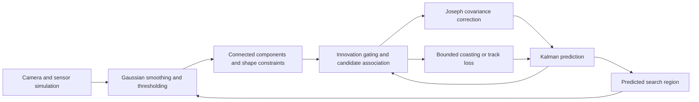
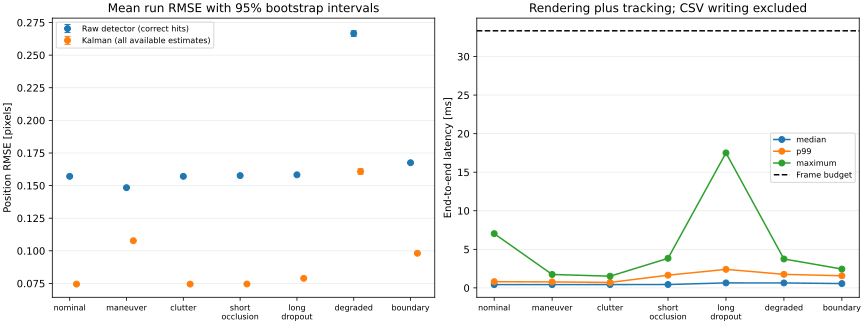

# Image-based tracking: requirements, design and validation

## Scope and acceptance

This project demonstrates single-target image tracking in C++ with a reproducible Python evaluation interface. The [acceptance plan](implementation-plan.md) defines the operating envelope and thresholds. The reference dataset is tied to the published source snapshot through the [source-content manifest](results/source-manifest.json). The manifest records SHA-256 digests for source, tests and build configuration without requiring development history.

The reference run covers 320 x 240 grayscale images at 30 frames/s. Each sequence has 120 frames. A fixed-depth pinhole camera uses focal lengths 200 pixels, principal point (160, 120) and depth 5 world units. The ordinary target starts at image position (40, 80), with velocity (40, 12) pixels/s. Rendering uses fixed-point subpixel circle coordinates. Pixel noise is independent Gaussian noise followed by 8-bit saturation.

## Pipeline



The state is (x, y, vx, vy). Each update takes an explicit time interval. Prediction uses the exact constant-velocity transition and the continuous white-acceleration covariance, with spectral density 64. The measurement is image position. The correction uses a factorization solve and Joseph covariance update.

The detector uses threshold 110, minimum area 20, 3 x 3 Gaussian smoothing, 3 x 3 elliptical opening, maximum bounding-box aspect ratio 2 and minimum circularity 0.45. Search windows are 63 x 63 pixels, shifted at image boundaries. Candidates are ranked by squared Mahalanobis innovation and rejected above 9.210340371976184. Full-frame fallback uses the same statistical gate. Initialization selects the largest admissible component. Identity is retained through five missing measurements; the sixth miss drops the state. Later initialization increments the identity.

## Experimental design

Calibration uses 20 nominal sequences with seeds 100..119. The measured position biases are (0.03052, 0.00722) pixels and sample variances are (0.00663, 0.01675) pixel squared. The isotropic measurement covariance is the larger sample variance with a conservative floor of 0.04 pixel squared. The same covariance is used for every validation scenario; it is not retuned on validation data. Process-noise density and detector settings are fixed.

Validation uses seeds 20000..20099 for each of seven scenarios: 700 independent runs and 84,000 frames. Image noise is generated independently by run and frame; common seeds across scenarios deliberately support comparison under matching noise. The renderer is stateless, so random access does not alter subsequent frames.

| Scenario | Change from nominal |
| --- | --- |
| nominal | Radius 5, background 20, target 220, noise standard deviation 30 |
| maneuver | Sinusoidal vertical motion: y = 100 + 15 sin(1.5t); analytic velocity |
| clutter | A nearby radius-4 distractor and a larger distant disk appear after frame 9 |
| short_occlusion | Target absent in frames 45..47 |
| long_dropout | Target absent in frames 45..56 |
| degraded | Background 50 + 20 sin(t), target 165, 3 x 3 image blur, noise standard deviation 35 |
| boundary | Initial x = 3 pixels; the target starts partially clipped |

A correct association requires an accepted measurement within 3 pixels of truth on a visible frame. The correct-association rate divides by all visible frames, including initialization. Wrong associations include accepted clutter and accepted measurements during invisibility; their rate divides by all frames. Estimate availability counts both corrected and coasting states. RMSE below includes every available estimate, including invisible coasting frames. Missing states remain missing and are counted separately.

All reported accuracy values are means of run-level metrics. Position-error intervals use 1,000 percentile bootstrap resamples of independent runs, seed 314159. Frames within a run are not treated as independent samples. A degenerate bootstrap interval for perfect outcomes does not prove zero probability of failure outside the observed runs.

## Accuracy and lifecycle results

| Scenario | Correct associations | Position RMSE, pixels [95% interval] | Velocity RMSE, pixels/s | Estimate availability |
| --- | ---: | ---: | ---: | ---: |
| nominal | 100.000% | 0.07447 [0.07408, 0.07485] | 3.973 | 100.000% |
| maneuver | 100.000% | 0.10772 [0.10721, 0.10828] | 4.886 | 100.000% |
| clutter | 100.000% | 0.07447 [0.07408, 0.07485] | 3.973 | 100.000% |
| short_occlusion | 100.000% | 0.07455 [0.07413, 0.07499] | 3.973 | 100.000% |
| long_dropout | 100.000% | 0.07889 [0.07840, 0.07941] | 5.777 | 94.167% |
| degraded | 99.767% | 0.16084 [0.15870, 0.16289] | 4.254 | 100.000% |
| boundary | 99.992% | 0.09812 [0.09742, 0.09897] | 4.498 | 100.000% |

There were no wrong associations. All 100 short interruptions preserved identity and accepted the target on its first returning frame. All 100 long interruptions produced a lost event and a new identity on the first returning frame. The long-dropout availability explicitly exposes seven frames without an estimate in each sequence. Velocity errors include zero-velocity initialization transients and reinitialization after long loss.

## Uncertainty validation

Position 95% covariance-ellipse coverage was 100% in the first five scenarios, 99.25% in degraded imagery and 99.16% near the boundary. These results indicate conservative position uncertainty in the stated scenes. Accepted NIS means range from 0.61 to 1.56. Gating selects measurements and truncates this statistic; it cannot be compared directly to an unselected chi-square sample as a calibration test. The deterministic motion scenarios also differ from the filter's stochastic motion assumption.

A separate reference experiment therefore simulates the exact linear-Gaussian process and measurement model. Initial truth is drawn from the estimator's initial prior. No detection, gating or sample rejection is applied. Each trial contributes only its final-epoch statistic after 60 steps, preserving independence between samples.

The initial 2,000-trial pilot, seeds 900000..901999, produced mean NIS 1.97699 and mean NEES 4.15317. Its NEES exceeded the 95% ensemble interval [3.87699, 4.12490]. This diagnostic was retained. A disjoint confirmatory ensemble of 10,000 trials, seeds 1000000..1009999, produced:

| Statistic | Expected mean | Observed mean | 95% ensemble bounds |
| --- | ---: | ---: | ---: |
| NIS, dimension 2 | 2 | 1.96363 | [1.96099, 2.03939] |
| NEES, dimension 4 | 4 | 4.00826 | [3.94475, 4.05563] |

Bounds use the Wilson-Hilferty approximation to chi-square quantiles at the ensemble degrees of freedom. Both confirmatory diagnostics pass. Statistical acceptance has a nonzero false-rejection probability; a failed diagnostic is evidence to investigate, not by itself proof of an implementation defect.

## Latency measurement

Reference host: Intel Core i7-1185G7 at nominal 3.00 GHz, Windows x64, MSVC 19.51.36256.0, CMake 4.4.2, Eigen 3.4.0, OpenCV 4.13.0 and Python 3.10.8. The executable is an optimized Release build with sanitizers disabled. OpenCV uses one thread. This is an ordinary desktop run without CPU isolation, real-time scheduling or a controlled background-load guarantee.

`steady_clock` measures each frame. End-to-end latency includes rendering, sensor noise and the tracker; it excludes CSV serialization and disk I/O. Stage timings are enabled for the experiment. The first ten frames of each run are retained in raw data and excluded from steady-state summaries: 77,000 timed frames remain. Processing is not paced by wall-clock frame acquisition.

| Scenario | Median, ms | p99, ms | Observed maximum, ms | Latency standard deviation, ms | Budget misses |
| --- | ---: | ---: | ---: | ---: | ---: |
| nominal | 0.4250 | 0.8073 | 7.0350 | 0.1475 | 0 |
| maneuver | 0.4256 | 0.7756 | 1.7411 | 0.0861 | 0 |
| clutter | 0.4298 | 0.7071 | 1.5166 | 0.0611 | 0 |
| short_occlusion | 0.4381 | 1.6465 | 3.8357 | 0.3141 | 0 |
| long_dropout | 0.6461 | 2.4039 | 17.5044 | 0.5091 | 0 |
| degraded | 0.6402 | 1.7576 | 3.7486 | 0.3492 | 0 |
| boundary | 0.5598 | 1.5678 | 2.4405 | 0.3259 | 0 |

The worst scenario p99 is 2.404 ms against a 33.333 ms budget. Including all 7,000 warmup frames, the maximum over the complete 84,000-frame experiment is 17.504 ms, with 0 budget misses. Stage p99 maxima across scenarios are: rendering 1.852 ms, detection 1.230 ms, prediction 0.0046 ms, association 0.0038 ms and correction 0.0044 ms. Quantiles from different stages and scenarios must not be added. The larger costs are image processing and simulation, so additional predictor micro-optimization is not the current priority.

These measurements satisfy the specified soft real-time criterion on this host. They do not establish a worst-case execution-time bound, cover camera capture or transport, or guarantee deadlines on another machine. CI latency results are separate experiments on shared runners.



## Reproduction and verification

From a checkout with Python, Git, CMake and a supported C++ compiler:

```sh
python tools/build_project.py --preset release
python -m evaluation --executable out/managed/release/Release/tracking_experiment.exe --output out/experiments/reproduction --strict
python -m pip install -r evaluation/requirements-plot.txt
python -m evaluation.plot_results out/experiments/reproduction/report.json --output out/experiments/reproduction/plots
```

On Linux omit `Release/` and `.exe` from the executable path. See the README for manually supplied dependencies and sanitizer builds. The dependency manifest pins its registry and Eigen version; the managed build uses OpenCV 4.14.0, while the recorded local reference uses 4.13.0. Bitwise noise reproducibility is scoped to the same standard-library and OpenCV implementation. Timings are measurements and will vary on every run.

The [complete reference summary](results/validation-summary.json) retains configuration, run-level intervals, uncertainty diagnostics and stage distributions. Its raw CSV checksum identifies the measured artifact; it is not a promise that a new timing run has the same checksum. Raw experiment files remain outside Git and can be reproduced using the commands above. CI uploads its own raw data and test logs as short-lived artifacts.

The local suite contains 87 CTest cases, including C++ unit and sequence tests, independent Kalman consistency checks and Python interface tests. Debug, Release and AddressSanitizer runs pass. The [public CI workflow](https://github.com/johannesstengele/realtime-tracking-cpp/actions/workflows/build.yml) independently checks Debug, Release and full Monte Carlo evaluation on Windows and Linux. Linux CI also enables UndefinedBehaviorSanitizer for project code; external package binaries in that job are not instrumented. The local Windows diagnostic run additionally uses an AddressSanitizer build of OpenCV.

## Remaining limits

The demonstrator satisfies its simulated single-target scope. Initial acquisition cannot infer identity among equally plausible objects. Long loss discards identity rather than asserting recognition from appearance. Fixed-depth projection does not model unknown depth, distortion or a calibrated physical camera. Noise is simplified; real imagery can contain correlated noise, texture, motion blur and detector biases absent from these scenes. Dynamic allocation and full-frame fallback remain permitted and measured. Real-camera validation, multi-target tracking, hardware integration and formal hard real-time analysis require separate requirements and evidence.
